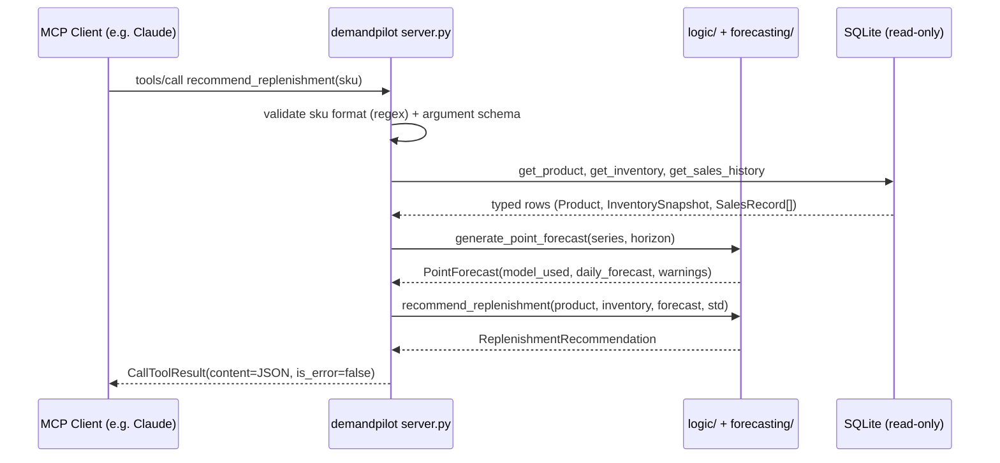

# Architecture

DemandPilot MCP is a local, stdio-only [Model Context Protocol](https://modelcontextprotocol.io)
server over a synthetic SQLite demo database. It is organized into four layers with a strict,
one-directional dependency order: **MCP server → business logic / forecasting → data access →
SQLite**. No layer depends on a layer above it.

## Layers

```text
demandpilot/
├── server.py            MCP server layer: tools, resource, prompt, validation, error mapping
├── __main__.py           CLI entry point (python -m demandpilot --db <path>)
├── data_gen.py           Synthetic data generator (separate process, writes the demo DB)
├── models.py             Shared dataclasses (Product, SalesRecord, InventorySnapshot, ...)
├── data/
│   ├── database.py       sqlite3 connection helpers (read-write for the generator,
│   │                     read-only for the server), schema initialization
│   ├── repository.py     Parameterized, read-only queries -> typed dataclasses
│   └── schema.sql         Table definitions, primary/foreign keys, CHECK constraints
├── logic/
│   ├── inventory.py       Inventory position + rule-based stockout risk
│   └── replenishment.py   (R, S) periodic-review replenishment math
└── forecasting/
    ├── models.py           Holt-Winters, Seasonal Naive, fallback hierarchy, prediction intervals
    └── evaluation.py       Chronological backtesting, MAE / WAPE / Forecast Bias
```

**Data layer** (`data/`) only talks to SQLite. It never computes forecasts or recommendations; it
hands back typed dataclasses from `models.py`.

**Business logic layer** (`logic/`) is pure Python: no imports from `mcp`, no SQL, no I/O. Every
function takes already-loaded data (a `Product`, an `InventorySnapshot`, a forecast number) and
returns a result. This is what makes the replenishment math unit-testable with hand-calculated
reference values, independent of the database or the MCP protocol.

**Forecasting layer** (`forecasting/`) is also pure: it takes a plain list of observed daily
quantities and a horizon, and returns a forecast, optional prediction interval, and optional
backtest metrics. It never sees SKUs, dates, or the database - the MCP layer is responsible for
turning sales history rows into a plain series and warning about gaps (see "Missing observations"
below).

**MCP server layer** (`server.py`) is the only layer that imports `mcp`. It:
1. opens a fresh **read-only** SQLite connection per tool call (`sqlite3` URI `mode=ro`),
2. validates arguments (Pydantic `Field` constraints on tool parameters catch out-of-range
   values before the function body runs; SKU format and existence are checked explicitly),
3. calls the data/business-logic/forecasting layers,
4. serializes the result to a plain `dict` (returned as JSON tool content),
5. maps anticipated failures to `ToolError` (never raw stack traces or local paths), and
6. closes the connection.

## Tool call flow



If any step raises an anticipated error (`ToolError`, e.g. `SKU_NOT_FOUND`), the SDK converts it
to `CallToolResult(is_error=True, content=[...])` instead of crashing the process or the session;
a subsequent tool call on the same session continues to work (verified in
`tests/test_mcp_integration.py::test_process_survives_a_tool_error_and_keeps_serving`).

## Communication: stdio only

The server is started as `python -m demandpilot --db <path>` and communicates exclusively over
stdin/stdout using the MCP JSON-RPC framing (`mcp.server.run(transport="stdio")`). All logging
goes to stderr. No HTTP, no sockets, no other transport is implemented or imported.

## Data model

```text
products(sku PK, product_name, demand_profile, lead_time_days, review_period_days,
         service_level, moq, pack_size)
sales_history(sku FK -> products, date, quantity_sold, is_promotion, is_stockout)
    PRIMARY KEY (sku, date)
inventory(sku FK -> products, as_of_date, on_hand, on_order, reserved)
    PRIMARY KEY (sku, as_of_date)
dataset_metadata(is_synthetic, seed, reference_date, generator_version)
```

CHECK constraints enforce non-negative quantities, `0 < service_level < 1`, `pack_size > 0`, and
`moq >= 0` at write time (in the generator); the server never writes, so these constraints are a
generator-time integrity guarantee, not a runtime one.

### Missing observations vs. zero demand

A day with no `sales_history` row is not the same as a day with `quantity_sold = 0`: the
generator intentionally omits a small fraction of days to model "no observation" (e.g. a feed
outage), distinct from "no_sales" SKUs, which have a real zero-quantity row every day. The
forecasting layer only ever sees the sequence of *observed* values (gaps are compressed, not
imputed as zero); `server.py` separately counts the gap and surfaces it as a warning in the
`forecast_demand` response.

## Error handling

`server.py` raises `mcp.server.mcpserver.exceptions.ToolError` for every anticipated failure,
prefixed with a domain code (`SKU_NOT_FOUND`, `INVALID_ARGUMENT`, `FORECAST_FAILED`,
`DATABASE_UNAVAILABLE`); the SDK logs it at INFO without a traceback and returns it to the client
as `CallToolResult(is_error=True)`. Argument-schema violations (e.g. `horizon_days=999`) are
rejected automatically by the Pydantic-generated input schema before the tool body runs. Any
genuinely unexpected exception is still caught by the SDK one level up and reported generically
(`Error executing tool <name>`) without leaking local paths or stack traces to the client; it is
logged with a traceback on the server's stderr for local debugging.

## Security

- The server opens the database with `sqlite3` URI `mode=ro`: a connection-level guarantee, not
  just an application convention - an `INSERT`/`UPDATE`/`DELETE` attempted through this
  connection raises `sqlite3.OperationalError` (verified in
  `tests/test_database.py::test_connect_ro_connection_rejects_writes`).
- All SQL is parameterized (`?` placeholders); no tool argument is ever concatenated into a SQL
  string.
- No tool argument can name an arbitrary file path; the only path-like input is `--db` on the
  command line, set once at process startup, not per call.
- No network access, no secrets, no API keys are used by the server or the generator.

## Why this stack (and not more)

- **`mcp.server.MCPServer`** (not `FastMCP`): the official SDK's v2 line renamed `FastMCP` to
  `MCPServer`; see the Specification Deviations section of the final report for the full
  rationale. Behavior and decorator API are otherwise identical to what the spec describes.
- **SQLite + stdlib `sqlite3`**: the whole dataset is a few thousand rows; a server process is
  not needed, and read-only file-level access is the simplest way to guarantee the "no writes"
  requirement.
- **statsmodels Holt-Winters, not Prophet/ARIMA/XGBoost**: the spec deliberately scopes
  forecasting to one well-understood, classical method plus a naive baseline, to keep the
  statistical claims honest and auditable rather than maximizing model count.
- **No HTTP/FastAPI/Docker/cloud services**: out of scope for a local, single-user demo server;
  see `SPECIFICATION.md` section 17 for the full list of excluded technologies and the reasoning
  (this is a portfolio project, not a production deployment).
